# L4 TCP Load Balancer

Minimal, zero-dependency Layer 4 (TCP) stream proxy and load balancer implemented in pure Python using native `asyncio`.

```
                    +-------------------+
                    |    TCP Clients    |
                    +---------+---------+
                              |
                              v
                    +-------------------+
                    |  balancer :8080   | <--- SIGHUP (Hot Reload)
                    +---------+---------+
                              |
          +-------------------+-------------------+
          |                   |                   |
          v                   v                   v
+-------------------+ +-------------------+ +-------------------+
|  backend-1 :9001  | |  backend-2 :9002  | |  backend-3 :9003  |
+-------------------+ +-------------------+ +-------------------+
          ^                   ^                   ^
          |                   |                   |
          +===================+===================+
                    Active TCP Health Probes
                              |
                    +---------+---------+
                    |   admin :8081     | ---> /metrics (Prometheus)
                    |   [admin.py]      | ---> /stats (JSON)
                    +-------------------+ ---> /healthz
```



---

## Architecture

| Component | File | Responsibility |
|---|---|---|
| Listener & Lifecycle | `balancer.py` | TCP listener (`SO_REUSEADDR`), `SIGHUP` hot reload, signal traps (`SIGINT`/`SIGTERM`), worker coordination. |
| Health Engine & Pool | `health.py` | Active TCP handshake probes, rise/fall hysteresis, multi-algorithm dispatch, connection draining. |
| Stream Proxy | `proxy.py` | Full-duplex byte piping (64 KB buffers), token-bucket IP rate limiter, PROXY protocol v1 injection, `RST` cleanup. |
| Admin & Observability | `admin.py` | Standalone async HTTP server serving Prometheus `/metrics`, operational `/stats`, and readiness `/healthz`. |
| Configuration | `config.json` | Listener addresses, target pool, routing strategy, probe thresholds, and rate limits. |

---

## Core Capabilities

### 1. Multi-Strategy Dispatch
Selectable via `algorithm` in `config.json`:
- `round_robin`: Atomic sequential rotation across healthy backends.
- `least_connections`: Routes to the active backend with lowest in-flight connections.
- `ip_hash`: Consistent MD5 hashing of client IP for sticky session persistence without application cookies.
- `weighted_round_robin`: Nginx-style smooth weighted round-robin avoiding traffic bursts to high-weight targets.

### 2. Zero-Downtime Hot Reload & Draining (`SIGHUP`)
Send `SIGHUP` to the balancer process:
```bash
kill -HUP $(pgrep -f "balancer.py")
```
- Re-reads `config.json` without dropping client connections or restarting the listener.
- Retains existing backend connection counters.
- Targets removed from config enter `draining = true` state: stopped from receiving new connections while existing in-flight streams finish cleanly. Once idle, the node is culled.

### 3. Observability & Prometheus Metrics
Separate internal HTTP server on `:8081`:
- `GET /metrics`: Standard Prometheus exposition format for scraping.
  - `balancer_active_connections`, `balancer_connections_total`, `balancer_rate_limited_total`
  - `balancer_bytes_in_total`, `balancer_bytes_out_total`
  - `balancer_backend_alive{endpoint="...",draining="..."}`, `balancer_backend_active_connections`
- `GET /stats`: Real-time structured JSON runtime summary.
- `GET /healthz`: Kubernetes-ready readiness probe (HTTP 200 when alive backends > 0, HTTP 503 if pool exhausted).

### 4. Abuse Protection & Rate Limiting
- **Per-IP Token Bucket**: Enforces sustained request rate and burst ceiling per client IP. Rejections close sockets immediately.
- **Global Concurrency Ceiling**: Drops new TCP handshakes when total active connections reach `max_connections`.

### 5. PROXY Protocol v1 Support
When `proxy_protocol: true`, prepends an HAProxy-compliant `PROXY TCP4/TCP6 <client_ip> <server_ip> <client_port> <server_port>\r\n` header before streaming raw bytes, preserving real client addresses for upstream services.

---

## Failure Modes & Resilience

- **Backend Crash / Timeout**: Upstream connection failure within `connection_timeout` cleanly tears down client socket and increments failure counters.
- **Flap Damping**: Requires `fall_threshold` consecutive failed probes to mark dead, and `rise_threshold` consecutive passes to reinstate.
- **Client Drop**: Sudden client disconnect (`ECONNRESET` / `EPIPE`) terminates the corresponding backend pipe immediately without dangling socket leaks.
- **Pool Exhaustion**: When all targets fail, incoming connections are dropped cleanly with zero CPU spin.

---

## Configuration

`config.json`:
```json
{
  "bind_host": "0.0.0.0",
  "bind_port": 8080,
  "algorithm": "round_robin",
  "max_connections": 10000,
  "proxy_protocol": false,
  "connection_timeout": 5.0,
  "backends": [
    {"host": "127.0.0.1", "port": 9001, "weight": 1},
    {"host": "127.0.0.1", "port": 9002, "weight": 2},
    {"host": "127.0.0.1", "port": 9003, "weight": 1}
  ],
  "health_check": {
    "interval_seconds": 2.0,
    "timeout_seconds": 1.0,
    "rise_threshold": 2,
    "fall_threshold": 2
  },
  "admin": {
    "enabled": true,
    "host": "127.0.0.1",
    "port": 8081
  },
  "rate_limit": {
    "enabled": false,
    "rate": 50.0,
    "burst": 100.0
  }
}
```

---

## Quickstart

### Prerequisites
Python 3.8+ (standard library only).

### Run
```bash
python3 balancer.py config.json
```

### Inspect Metrics & Health
```bash
curl http://127.0.0.1:8081/metrics
curl http://127.0.0.1:8081/stats
curl http://127.0.0.1:8081/healthz
```

### Run Comprehensive Test Suite
Verifies all 4 dispatch algorithms, active failover/recovery, Prometheus endpoints, rate limiting, and zero-downtime draining:
```bash
python3 test_balancer.py
```

### Interactive Failover Demo
```bash
./demo.sh
```

---

## Benchmarking

```bash
# Automated benchmark runner (auto-detects wrk / hey / python fallback)
./benchmark.sh

# Direct wrk invocation
wrk -t4 -c100 -d10s --latency http://127.0.0.1:8080/
```
